<!-- Generated by pnpm build. Edit content/, not this file. -->

<picture>
  <source media="(prefers-color-scheme: dark)" srcset="assets/generated/header-dark.svg">
  
</picture>

<picture>
  <source media="(prefers-color-scheme: dark)" srcset="assets/generated/typing-dark.svg">
  
</picture>

<h2><picture><source media="(prefers-color-scheme: dark)" srcset="assets/generated/heading-about-dark.svg"></picture> About me</h2>

<i>“You can&#39;t beat someone who is having fun.”</i>

<a href="https://www.linkedin.com/in/nguyenducloc404"><picture>
  <source media="(prefers-color-scheme: dark)" srcset="assets/generated/contact-linkedin-dark.svg">
  
</picture></a>
<a href="https://www.credly.com/users/nguyenducloc"><picture>
  <source media="(prefers-color-scheme: dark)" srcset="assets/generated/contact-credly-dark.svg">
  
</picture></a>
<a href="https://leetcode.com/u/nguyenducloc"><picture>
  <source media="(prefers-color-scheme: dark)" srcset="assets/generated/contact-leetcode-dark.svg">
  
</picture></a>
<a href="mailto:nguyenducloc404@gmail.com"><picture>
  <source media="(prefers-color-scheme: dark)" srcset="assets/generated/contact-gmail-dark.svg">
  
</picture></a>

<h2><picture><source media="(prefers-color-scheme: dark)" srcset="assets/generated/heading-experience-dark.svg"></picture> Experience</h2>

<a href="https://www.linkedin.com/in/nguyenducloc404"><picture>
  <source media="(prefers-color-scheme: dark)" srcset="assets/generated/timeline-experience-dark.svg">
  
</picture></a>

<h2><picture><source media="(prefers-color-scheme: dark)" srcset="assets/generated/heading-education-dark.svg"></picture> Education</h2>

<a href="https://www.linkedin.com/in/nguyenducloc404"><picture>
  <source media="(prefers-color-scheme: dark)" srcset="assets/generated/timeline-education-dark.svg">
  
</picture></a>

<h2><picture><source media="(prefers-color-scheme: dark)" srcset="assets/generated/heading-certifications-dark.svg"></picture> Certifications</h2>

<table>
<tr>
<td width="25%"><b>Amazon Web Services Training and Certification</b></td>
<td width="75%">
<a href="https://www.credly.com/badges/a91ec8d7-61ac-4942-9602-81dd390937ee"><picture><source media="(prefers-color-scheme: dark)" srcset="https://images.credly.com/images/2d84e428-9078-49b6-a804-13c15383d0de/image.png"></picture></a>
<a href="https://www.credly.com/badges/47479d9b-a0df-4b9b-a21e-131b7e2e47fd"><picture><source media="(prefers-color-scheme: dark)" srcset="https://images.credly.com/images/0e284c3f-5164-4b21-8660-0d84737941bc/image.png"></picture></a>
<a href="https://www.credly.com/badges/3e5121d4-834c-4349-93f7-4b668289e068"><picture><source media="(prefers-color-scheme: dark)" srcset="https://images.credly.com/images/b9feab85-1a43-4f6c-99a5-631b88d5461b/image.png"></picture></a>
<a href="https://www.credly.com/badges/a96d1e95-c52d-48c7-877d-00566838ce9f"><picture><source media="(prefers-color-scheme: dark)" srcset="https://images.credly.com/images/4d4693bb-530e-4bca-9327-de07f3aa2348/image.png"></picture></a>
<a href="https://www.credly.com/badges/0be55577-3faf-47f8-a01d-8f87b02fb49b"><picture><source media="(prefers-color-scheme: dark)" srcset="https://images.credly.com/images/00634f82-b07f-4bbd-a6bb-53de397fc3a6/image.png"></picture></a>
</td>
</tr>
<tr>
<td width="25%"><b>Google Cloud</b></td>
<td width="75%">
<a href="https://www.credly.com/badges/c85be083-e1d5-41b5-ace8-1e7a527f232d"><picture><source media="(prefers-color-scheme: dark)" srcset="https://images.credly.com/images/614465c6-1d80-4ae6-a323-753de224422a/image.png"></picture></a>
<a href="https://www.credly.com/badges/ad37e15a-bf02-4f1f-bc34-f0bf2c5164fe"><picture><source media="(prefers-color-scheme: dark)" srcset="https://images.credly.com/images/08096465-cbfc-4c3e-93e5-93c5aa61f23e/image.png"></picture></a>
</td>
</tr>
<tr>
<td width="25%"><b>IBM Professional Certification</b></td>
<td width="75%">
<a href="https://www.credly.com/badges/b11d2520-6967-412a-9ada-c5f9b20f1ac0"><picture><source media="(prefers-color-scheme: dark)" srcset="https://images.credly.com/images/6f614b71-3f2e-488e-8b29-71e90d4dbf80/blob"></picture></a>
</td>
</tr>
<tr>
<td width="25%"><b>The Linux Foundation</b></td>
<td width="75%">
<a href="https://www.credly.com/badges/c6dedda7-444d-4e13-9ae2-6598c073c82c"><picture><source media="(prefers-color-scheme: dark)" srcset="https://images.credly.com/images/90c78afd-e885-4525-8f5e-e5834d8cb13d/image.png"></picture></a>
</td>
</tr>
</table>

<h2><picture><source media="(prefers-color-scheme: dark)" srcset="assets/generated/heading-stack-dark.svg"></picture> Tech stack</h2>

<table>
<tr>
<td width="10%"><b>Languages</b></td>
<td width="90%">
<picture><source media="(prefers-color-scheme: dark)" srcset="assets/generated/stack-typescript-dark.svg"></picture>
<picture><source media="(prefers-color-scheme: dark)" srcset="assets/generated/stack-go-dark.svg"></picture>
<picture><source media="(prefers-color-scheme: dark)" srcset="assets/generated/stack-cplusplus-dark.svg"></picture>
<picture><source media="(prefers-color-scheme: dark)" srcset="assets/generated/stack-bash-dark.svg"></picture>
</td>
</tr>
<tr>
<td width="10%"><b>Frameworks</b></td>
<td width="90%">
<picture><source media="(prefers-color-scheme: dark)" srcset="assets/generated/stack-react-dark.svg"></picture>
<picture><source media="(prefers-color-scheme: dark)" srcset="assets/generated/stack-nextdotjs-dark.svg"></picture>
</td>
</tr>
<tr>
<td width="10%"><b>Tools</b></td>
<td width="90%">
<picture><source media="(prefers-color-scheme: dark)" srcset="assets/generated/stack-git-dark.svg"></picture>
<picture><source media="(prefers-color-scheme: dark)" srcset="assets/generated/stack-docker-dark.svg"></picture>
<picture><source media="(prefers-color-scheme: dark)" srcset="assets/generated/stack-terraform-dark.svg"></picture>
<picture><source media="(prefers-color-scheme: dark)" srcset="assets/generated/stack-linux-dark.svg"></picture>
<picture><source media="(prefers-color-scheme: dark)" srcset="assets/generated/stack-kubernetes-dark.svg"></picture>
</td>
</tr>
<tr>
<td width="10%"><b>Cloud</b></td>
<td width="90%">
<picture><source media="(prefers-color-scheme: dark)" srcset="assets/generated/stack-aws-dark.svg"></picture>
</td>
</tr>
</table>

<h2><picture><source media="(prefers-color-scheme: dark)" srcset="assets/generated/heading-leetcode-dark.svg"></picture> LeetCode</h2>

<a href="https://leetcode.com/u/nguyenducloc"><picture>
  <source media="(prefers-color-scheme: dark)" srcset="assets/generated/leetcode-contest-dark.svg">
  
</picture></a>

<a href="https://leetcode.com/u/nguyenducloc"><picture>
  <source media="(prefers-color-scheme: dark)" srcset="assets/generated/leetcode-summary-dark.svg">
  
</picture></a>

<a href="https://leetcode.com/u/nguyenducloc"><picture>
  <source media="(prefers-color-scheme: dark)" srcset="assets/generated/leetcode-heatmap-dark.svg">
  
</picture></a>

