<!-- Generated by pnpm build. Edit content/, not this file. -->

<picture>
  <source media="(prefers-color-scheme: dark)" srcset="assets/generated/header-dark.svg">
  
</picture>

<picture>
  <source media="(prefers-color-scheme: dark)" srcset="assets/generated/typing-dark.svg">
  
</picture>

<h2 align="center">About me</h2>

You can&#39;t beat someone who is having fun.

📍 Hanoi, Vietnam

<a href="https://www.linkedin.com/in/nguyenducloc404"><picture>
  <source media="(prefers-color-scheme: dark)" srcset="assets/generated/contact-linkedin-dark.svg">
  
</picture></a>
<a href="https://www.credly.com/users/nguyenducloc"><picture>
  <source media="(prefers-color-scheme: dark)" srcset="assets/generated/contact-credly-dark.svg">
  
</picture></a>
<a href="https://leetcode.com/u/nguyenducloc"><picture>
  <source media="(prefers-color-scheme: dark)" srcset="assets/generated/contact-leetcode-dark.svg">
  
</picture></a>
<a href="mailto:nguyenducloc404@gmail.com"><picture>
  <source media="(prefers-color-scheme: dark)" srcset="assets/generated/contact-email-dark.svg">
  
</picture></a>

<h2 align="center">Tech stack</h2>

<picture>
  <source media="(prefers-color-scheme: dark)" srcset="assets/generated/stack-languages-dark.svg">
  
</picture>
<picture>
  <source media="(prefers-color-scheme: dark)" srcset="assets/generated/stack-frameworks-dark.svg">
  
</picture>
<picture>
  <source media="(prefers-color-scheme: dark)" srcset="assets/generated/stack-tools-dark.svg">
  
</picture>
<picture>
  <source media="(prefers-color-scheme: dark)" srcset="assets/generated/stack-cloud-dark.svg">
  
</picture>

<h2 align="center">LeetCode</h2>

<a href="https://leetcode.com/u/nguyenducloc"><picture>
  <source media="(prefers-color-scheme: dark)" srcset="assets/generated/leetcode-contest-dark.svg">
  
</picture></a>

<a href="https://leetcode.com/u/nguyenducloc"><picture>
  <source media="(prefers-color-scheme: dark)" srcset="assets/generated/leetcode-solved-dark.svg">
  
</picture></a>
<a href="https://leetcode.com/u/nguyenducloc"><picture>
  <source media="(prefers-color-scheme: dark)" srcset="assets/generated/leetcode-badges-dark.svg">
  
</picture></a>

<a href="https://leetcode.com/u/nguyenducloc"><picture><source media="(prefers-color-scheme: dark)" srcset="https://leetcode.com/static/images/badges/guardian.png"></picture></a>
<a href="https://leetcode.com/u/nguyenducloc"><picture><source media="(prefers-color-scheme: dark)" srcset="https://assets.leetcode.com/static_assets/others/2026_1080_1080.png"></picture></a>
<a href="https://leetcode.com/u/nguyenducloc"><picture><source media="(prefers-color-scheme: dark)" srcset="https://assets.leetcode.com/static_assets/others/200_1080_1080.png"></picture></a>
<a href="https://leetcode.com/u/nguyenducloc"><picture><source media="(prefers-color-scheme: dark)" srcset="https://assets.leetcode.com/static_assets/others/100_1080_1080.png"></picture></a>
<a href="https://leetcode.com/u/nguyenducloc"><picture><source media="(prefers-color-scheme: dark)" srcset="https://assets.leetcode.com/static_assets/others/10801080.png"></picture></a>
<a href="https://leetcode.com/u/nguyenducloc"><picture><source media="(prefers-color-scheme: dark)" srcset="https://assets.leetcode.com/static_assets/others/50_1080_1080.png"></picture></a>
<a href="https://leetcode.com/u/nguyenducloc"><picture><source media="(prefers-color-scheme: dark)" srcset="https://assets.leetcode.com/static_assets/marketing/lg1k.png"></picture></a>
<a href="https://leetcode.com/u/nguyenducloc"><picture><source media="(prefers-color-scheme: dark)" srcset="https://assets.leetcode.com/static_assets/others/2025_lg.png"></picture></a>

<a href="https://leetcode.com/u/nguyenducloc"><picture>
  <source media="(prefers-color-scheme: dark)" srcset="assets/generated/leetcode-heatmap-dark.svg">
  
</picture></a>

<h2 align="center">Experience</h2>

<a href="https://www.linkedin.com/in/nguyenducloc404"><picture>
  <source media="(prefers-color-scheme: dark)" srcset="assets/generated/timeline-experience-dark.svg">
  
</picture></a>

<h2 align="center">Education</h2>

<a href="https://www.linkedin.com/in/nguyenducloc404"><picture>
  <source media="(prefers-color-scheme: dark)" srcset="assets/generated/timeline-education-dark.svg">
  
</picture></a>

<a href="https://www.linkedin.com/in/nguyenducloc404"><picture>
  <source media="(prefers-color-scheme: dark)" srcset="assets/generated/contact-linkedin-dark.svg">
  
</picture></a>

<h2 align="center">Certifications</h2>

<a href="https://www.credly.com/badges/a91ec8d7-61ac-4942-9602-81dd390937ee"><picture><source media="(prefers-color-scheme: dark)" srcset="https://images.credly.com/images/2d84e428-9078-49b6-a804-13c15383d0de/image.png"></picture></a>
<a href="https://www.credly.com/badges/47479d9b-a0df-4b9b-a21e-131b7e2e47fd"><picture><source media="(prefers-color-scheme: dark)" srcset="https://images.credly.com/images/0e284c3f-5164-4b21-8660-0d84737941bc/image.png"></picture></a>
<a href="https://www.credly.com/badges/3e5121d4-834c-4349-93f7-4b668289e068"><picture><source media="(prefers-color-scheme: dark)" srcset="https://images.credly.com/images/b9feab85-1a43-4f6c-99a5-631b88d5461b/image.png"></picture></a>
<a href="https://www.credly.com/badges/a96d1e95-c52d-48c7-877d-00566838ce9f"><picture><source media="(prefers-color-scheme: dark)" srcset="https://images.credly.com/images/4d4693bb-530e-4bca-9327-de07f3aa2348/image.png"></picture></a>
<a href="https://www.credly.com/badges/0be55577-3faf-47f8-a01d-8f87b02fb49b"><picture><source media="(prefers-color-scheme: dark)" srcset="https://images.credly.com/images/00634f82-b07f-4bbd-a6bb-53de397fc3a6/image.png"></picture></a>
<a href="https://www.credly.com/badges/c85be083-e1d5-41b5-ace8-1e7a527f232d"><picture><source media="(prefers-color-scheme: dark)" srcset="https://images.credly.com/images/614465c6-1d80-4ae6-a323-753de224422a/image.png"></picture></a>
<a href="https://www.credly.com/badges/ad37e15a-bf02-4f1f-bc34-f0bf2c5164fe"><picture><source media="(prefers-color-scheme: dark)" srcset="https://images.credly.com/images/08096465-cbfc-4c3e-93e5-93c5aa61f23e/image.png"></picture></a>
<a href="https://www.credly.com/badges/b11d2520-6967-412a-9ada-c5f9b20f1ac0"><picture><source media="(prefers-color-scheme: dark)" srcset="https://images.credly.com/images/6f614b71-3f2e-488e-8b29-71e90d4dbf80/blob"></picture></a>
<a href="https://www.credly.com/badges/c6dedda7-444d-4e13-9ae2-6598c073c82c"><picture><source media="(prefers-color-scheme: dark)" srcset="https://images.credly.com/images/90c78afd-e885-4525-8f5e-e5834d8cb13d/image.png"></picture></a>

<a href="https://www.credly.com/users/nguyenducloc"><picture>
  <source media="(prefers-color-scheme: dark)" srcset="assets/generated/contact-credly-dark.svg">
  
</picture></a>

