<!-- Generated by pnpm build. Edit content/, not this file. -->

<picture>
  <source media="(prefers-color-scheme: dark)" srcset="assets/generated/header-dark.svg">
  
</picture>

<picture>
  <source media="(prefers-color-scheme: dark)" srcset="assets/generated/typing-dark.svg">
  
</picture>

<h2 align="center">About me</h2>

You can&#39;t beat someone who is having fun.

📍 Hanoi, Vietnam

<a href="https://www.linkedin.com/in/nguyenducloc404"><picture>
  <source media="(prefers-color-scheme: dark)" srcset="assets/generated/contact-linkedin-dark.svg">
  
</picture></a>
<a href="https://www.credly.com/users/nguyenducloc"><picture>
  <source media="(prefers-color-scheme: dark)" srcset="assets/generated/contact-credly-dark.svg">
  
</picture></a>
<a href="https://leetcode.com/u/nguyenducloc"><picture>
  <source media="(prefers-color-scheme: dark)" srcset="assets/generated/contact-leetcode-dark.svg">
  
</picture></a>
<a href="mailto:nguyenducloc404@gmail.com"><picture>
  <source media="(prefers-color-scheme: dark)" srcset="assets/generated/contact-email-dark.svg">
  
</picture></a>

<h2 align="center">Tech stack</h2>

<picture>
  <source media="(prefers-color-scheme: dark)" srcset="assets/generated/stack-languages-dark.svg">
  
</picture>
<picture>
  <source media="(prefers-color-scheme: dark)" srcset="assets/generated/stack-frameworks-dark.svg">
  
</picture>
<picture>
  <source media="(prefers-color-scheme: dark)" srcset="assets/generated/stack-tools-dark.svg">
  
</picture>
<picture>
  <source media="(prefers-color-scheme: dark)" srcset="assets/generated/stack-cloud-dark.svg">
  
</picture>

<h2 align="center">LeetCode</h2>

<a href="https://leetcode.com/u/nguyenducloc"><picture>
  <source media="(prefers-color-scheme: dark)" srcset="assets/generated/leetcode-contest-dark.svg">
  
</picture></a>

<a href="https://leetcode.com/u/nguyenducloc"><picture>
  <source media="(prefers-color-scheme: dark)" srcset="assets/generated/leetcode-solved-dark.svg">
  
</picture></a>

